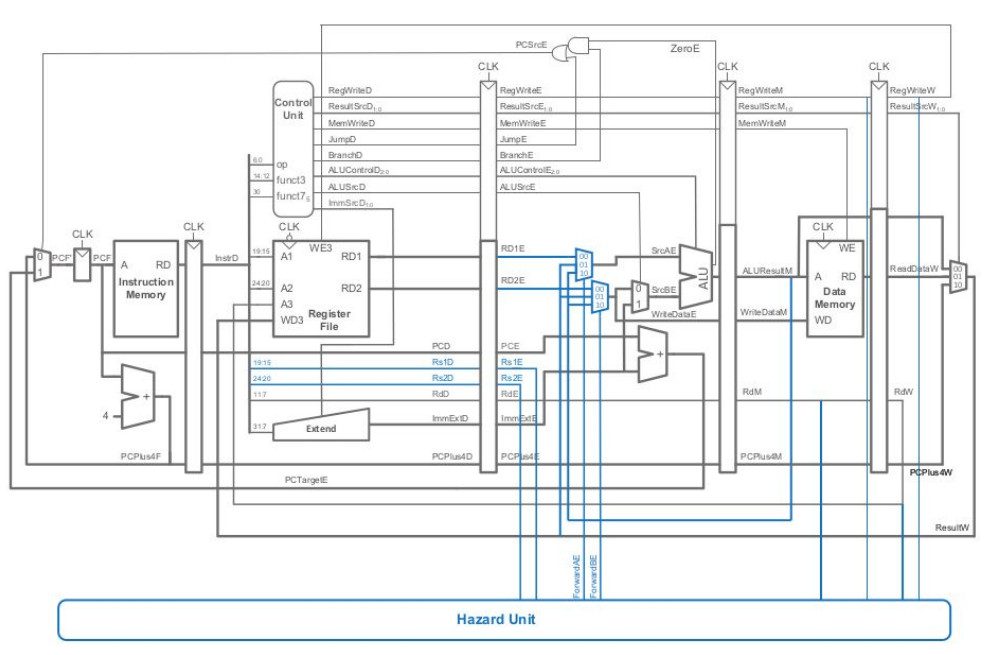
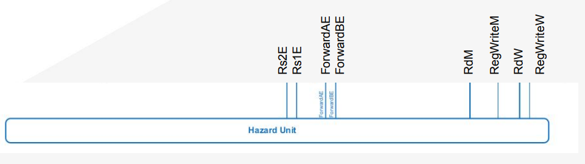
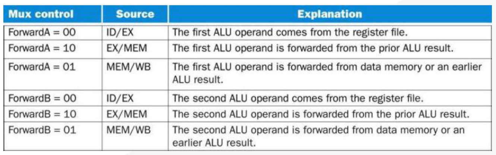
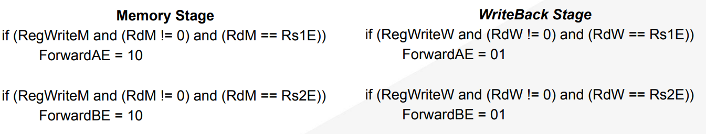
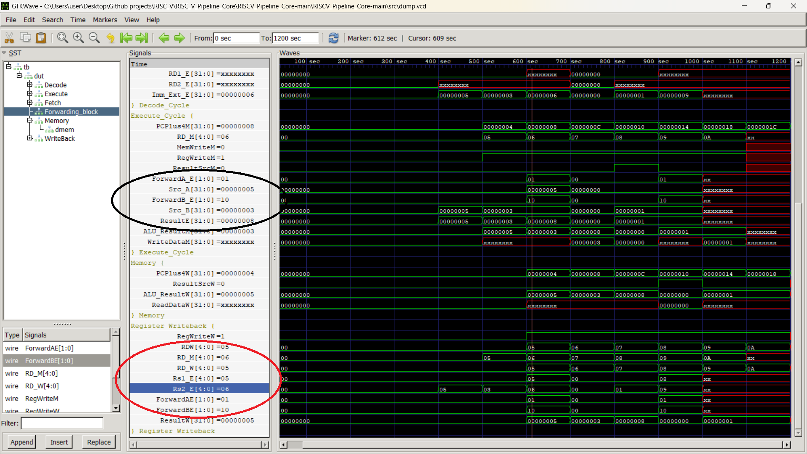
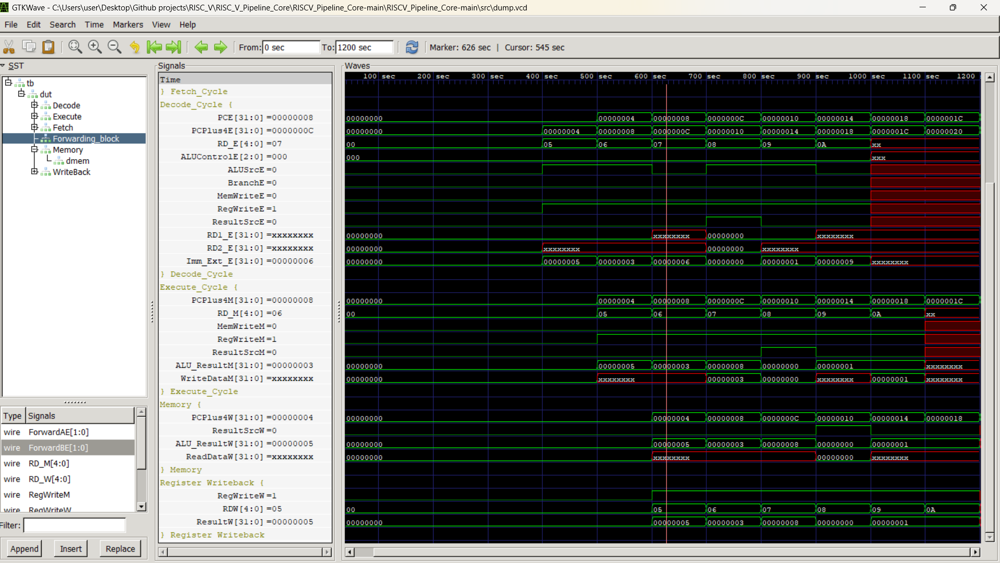

# RISC-V 32I 5-Stage Pipelined Processor Core

[](https://riscv.org/)
[](#)
[](https://bleyer.org/icarus/)
[](http://gtkwave.sourceforge.net/)

A synthesizable, cycle-accurate implementation of a **5-stage pipelined RISC-V 32I (RV32I) processor core** modeled in Verilog HDL. This core implements the fundamental 5-stage RISC datapath with dedicated pipeline registers and an integrated **Hazard Unit** capable of resolving Data and Structural hazards using operand forwarding and bypassing techniques.

---

## Table of Contents
- [Architecture Overview](#architecture-overview)
- [Pipeline Stages](#pipeline-stages)
- [Hazard Detection & Forwarding Unit](#hazard-detection--forwarding-unit)
- [Instruction Set Architecture (ISA) Support](#instruction-set-architecture-isa-support)
- [Directory Structure](#directory-structure)
- [Simulation & Verification](#simulation--verification)
  - [Prerequisites](#prerequisites)
  - [Compilation & Execution](#compilation--execution)
  - [Viewing Waveforms in GTKWave](#viewing-waveforms-in-gtkwave)
  - [Sample Verification Program](#sample-verification-program)
- [Simulation Results](#simulation-results)
- [License & Acknowledgments](#license--acknowledgments)

---

## Architecture Overview

The core is structured around a classic 5-stage RISC pipeline consisting of **Fetch (IF)**, **Decode (ID)**, **Execute (EX)**, **Memory (MEM)**, and **Write-Back (WB)**. Inter-stage pipeline registers ensure synchronized data progression and timing isolation across stage boundaries.

### Top-Level Datapath Block Diagram


---

## Pipeline Stages

```
   +-------------+      +--------------+      +---------------+      +--------------+      +----------------+
   |   Fetch     | ---> |    Decode    | ---> |    Execute    | ---> |    Memory    | ---> |   Write-Back   |
   |    (IF)     |      |     (ID)     |      |     (EX)      |      |    (MEM)     |      |      (WB)      |
   +-------------+      +--------------+      +---------------+      +--------------+      +----------------+
```

### 1. Instruction Fetch (IF)
- **Module:** [`Fetch_Cycle.v`](src/Fetch_Cycle.v)
- **Functions:**
  - Maintains the Program Counter ([`PC.v`](src/PC.v)).
  - Fetches 32-bit instructions from Instruction Memory ([`Instruction_Memory.v`](src/Instruction_Memory.v)).
  - Computes sequential target address (`PC + 4`) using [`PC_Adder.v`](src/PC_Adder.v).
  - Selects between sequential (`PC + 4`) and branch/jump target (`PCTargetE`) via multiplexer based on `PCSrcE`.
  - Propagates `InstrD`, `PCD`, and `PCPlus4D` across the IF/ID register.

### 2. Instruction Decode (ID)
- **Module:** [`Decode_Cycle.v`](src/Decode_Cycle.v)
- **Functions:**
  - Decodes instruction fields using the Control Unit ([`Control_Unit_Top.v`](src/Control_Unit_Top.v), [`Main_Decoder.v`](src/Main_Decoder.v), [`ALU_Decoder.v`](src/ALU_Decoder.v)).
  - Reads source registers `rs1` and `rs2` from the 32-entry Register File ([`Register_File.v`](src/Register_File.v)).
  - Generates 32-bit sign-extended immediates via [`Sign_Extend.v`](src/Sign_Extend.v) (supporting I-type, S-type, B-type, etc.).
  - Propagates control signals, operand values, register addresses, and PC values into the ID/EX pipeline register.

### 3. Instruction Execute (EX)
- **Module:** [`Execute_Cycle.v`](src/Execute_Cycle.v)
- **Functions:**
  - Selects operands using 3-to-1 forwarding multiplexers (`srca_mux`, `srcb_mux`) to accept forwarded results from MEM or WB stages.
  - Chooses between forwarded `rs2` data and sign-extended immediate via `ALUSrcE`.
  - Performs arithmetic, logical, comparison, and address calculations using the ALU ([`ALU.v`](src/ALU.v)).
  - Evaluates branch conditions (`ZeroE & BranchE`) and calculates branch target PC (`PCE + Imm_Ext_E`).
  - Latches ALU results, write data, destination register index, and control signals into the EX/MEM pipeline register.

### 4. Memory Access (MEM)
- **Module:** [`Memory_Cycle.v`](src/Memory_Cycle.v)
- **Functions:**
  - Performs synchronous write and asynchronous read operations on the 32-bit Data Memory ([`Data_Memory.v`](src/Data_Memory.v)).
  - For store operations (`MemWriteM = 1`), writes `WriteDataM` into address `ALU_ResultM`.
  - For load operations, provides `ReadDataM` to the MEM/WB register.
  - Passes `ALU_ResultM`, `PCPlus4M`, and destination register `RD_M` down to the write-back stage.

### 5. Write-Back (WB)
- **Module:** [`Writeback_Cycle.v`](src/Writeback_Cycle.v)
- **Functions:**
  - Selects the final result (`ResultW`) between memory read data (`ReadDataW`) and ALU computation result (`ALU_ResultW`) based on `ResultSrcW`.
  - Writes back `ResultW` into the destination register (`RDW`) of the Register File when `RegWriteW` is asserted.

---

## Hazard Detection & Forwarding Unit

In a pipelined processor, data dependencies between instructions in consecutive pipeline stages can cause **Read-After-Write (RAW)** data hazards. Rather than introducing pipeline stalls (nops), this processor incorporates a dedicated **Hazard Unit** ([`Hazard_Unit.v`](src/Hazard_Unit.v)) that dynamically forwards unwritten results from downstream stages to the execution stage.

### Hazard Architecture


### Forwarding Conditions & Logic
Forwarding occurs when a source register in the EX stage matches a destination register of an instruction currently in the MEM stage or the WB stage (provided destination register is not `x0` and write-enable is asserted).



#### Forwarding to Operand A (`ForwardAE`):
```verilog
assign ForwardAE = (rst == 1'b0) ? 2'b00 : 
                   ((RegWriteM == 1'b1) && (RD_M != 5'h00) && (RD_M == Rs1_E)) ? 2'b10 :
                   ((RegWriteW == 1'b1) && (RD_W != 5'h00) && (RD_W == Rs1_E)) ? 2'b01 : 2'b00;
```

#### Forwarding to Operand B (`ForwardBE`):
```verilog
assign ForwardBE = (rst == 1'b0) ? 2'b00 : 
                   ((RegWriteM == 1'b1) && (RD_M != 5'h00) && (RD_M == Rs2_E)) ? 2'b10 :
                   ((RegWriteW == 1'b1) && (RD_W != 5'h00) && (RD_W == Rs2_E)) ? 2'b01 : 2'b00;
```

| Mux Select | Forwarding Source | Description |
|:----------:|:-----------------|:------------|
| `2'b00` | ID/EX Register (`RD1_E` / `RD2_E`) | No hazard detected; operands read from Register File |
| `2'b01` | WB Stage (`ResultW`) | Forwarding from Write-Back stage |
| `2'b10` | MEM Stage (`ALU_ResultM`) | Forwarding from Memory stage |

### Hazard Detection Breakdown


### Timing & Hazard Waveform Analysis


---

## Instruction Set Architecture (ISA) Support

The processor supports the standard RV32I instruction formats:
- **R-Type:** Arithmetic and logic operations between registers (`ADD`, `SUB`, `AND`, `OR`, `SLT`).
- **I-Type:** Immediate arithmetic, comparisons, and load instructions (`ADDI`, `LW`).
- **S-Type:** Memory store instructions (`SW`).
- **B-Type:** Conditional branch operations (`BEQ`).
- **J-Type / U-Type:** Jump and upper immediate operations.

---

## Directory Structure

```
RISC-V-32I-5-stage-Pipeline-Core/
├── .gitignore                      # Git ignore rules for hidden & simulation files
├── README.md                       # Project documentation
├── doc/                            # Architectural diagrams & waveform documentation
│   ├── block_diagram.png           # Top-level pipelined datapath diagram
│   ├── condition_for_data_hazard.png# Hazard condition specification
│   ├── condition_table.png         # Forwarding logic truth table
│   ├── hazard_architecture.png     # Hazard forwarding hardware block diagram
│   ├── hazard_exp.png              # Hazard resolution waveform walkthrough
│   └── pipeline_waveform.png       # Comprehensive GTKWave simulation output
└── src/                            # Verilog HDL source files & testbench
    ├── ALU.v                       # Arithmetic Logic Unit
    ├── ALU_Decoder.v               # ALU function control decoder
    ├── Control_Unit_Top.v          # Central control unit top module
    ├── Data_Memory.v               # 32-bit Data RAM memory module
    ├── Decode_Cycle.v              # Instruction Decode (ID) stage wrapper
    ├── Execute_Cycle.v             # Instruction Execute (EX) stage wrapper
    ├── Fetch_Cycle.v               # Instruction Fetch (IF) stage wrapper
    ├── Hazard_Unit.v               # Data hazard detection & operand forwarding unit
    ├── Instruction_Memory.v        # ROM instruction memory initialized via $readmemh
    ├── Main_Decoder.v              # Primary opcode decoder
    ├── memfile.hex                 # Hex machine code program for execution
    ├── Memory_Cycle.v              # Memory Access (MEM) stage wrapper
    ├── Mux.v                       # 2:1 and 3:1 parameterizable multiplexers
    ├── PC.v                        # 32-bit Program Counter register
    ├── PC_Adder.v                  # 32-bit branch/PC adder
    ├── pipeline.gtkw                # Pre-configured GTKWave signal workspace
    ├── pipeline_tb.v               # Testbench verifying pipeline execution
    ├── Pipeline_Top.v              # Top-level processor module integrating all stages
    ├── Register_File.v             # 32 x 32-bit dual-read single-write register file
    ├── Sign_Extend.v               # Immediate sign extension unit
    └── Writeback_Cycle.v           # Write-back (WB) stage multiplexer
```

---

## Simulation & Verification

### Prerequisites
- **Icarus Verilog (`iverilog`)**: Verilog compiler and simulator ([Download](https://bleyer.org/icarus/))
- **GTKWave (`gtkwave`)**: Waveform visualizer ([Download](http://gtkwave.sourceforge.net/))

### Compilation & Execution
Navigate into the `src/` directory and compile using `iverilog`:

```bash
# Navigate to the source folder
cd src

# Compile testbench and top-level pipeline core
iverilog -Wall -o sim.vvp pipeline_tb.v Pipeline_Top.v

# Execute simulation with vvp
vvp sim.vvp
```

### Viewing Waveforms in GTKWave
Open the generated Value Change Dump (`dump.vcd`) using the pre-configured GTKWave workspace:

```bash
gtkwave dump.vcd pipeline.gtkw
```

### Sample Verification Program
The processor executes the preloaded hex assembly program located in [`src/memfile.hex`](src/memfile.hex):

```hex
@00000000
00500293   // addi x5, x0, 5    ; Load immediate 5 into x5 (t0)
00300313   // addi x6, x0, 3    ; Load immediate 3 into x6 (t1)
006283B3   // add  x7, x5, x6   ; x7 = x5 + x6 = 8 (tests EX/MEM forwarding hazard)
00002403   // lw   x8, 0(x0)    ; Load word from address 0 into x8
00100493   // addi x9, x0, 1    ; Load immediate 1 into x9
00940533   // add  x10, x8, x9  ; x10 = x8 + x9
```

This sequence explicitly triggers data hazard conditions to verify the proper operation of the operand forwarding network under real pipeline conditions.

---

## Simulation Results

The simulation trace demonstrates seamless pipeline execution without stalls for arithmetic dependencies due to immediate data forwarding:



---

## License & Acknowledgments

This project is developed as an educational and reference design for pipelined RISC-V architectures. Contributions and suggestions are welcome.
